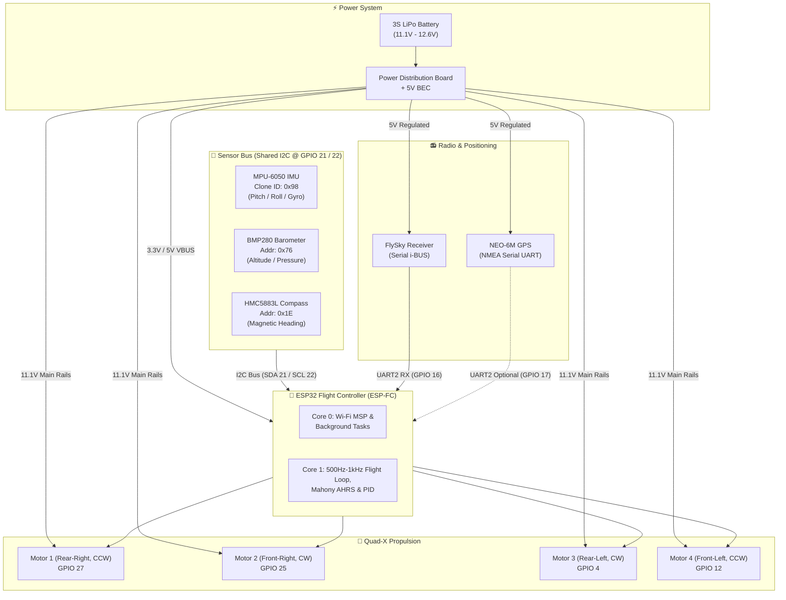
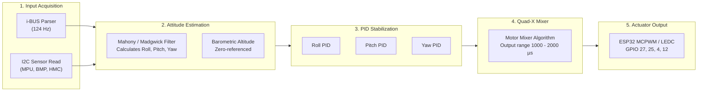
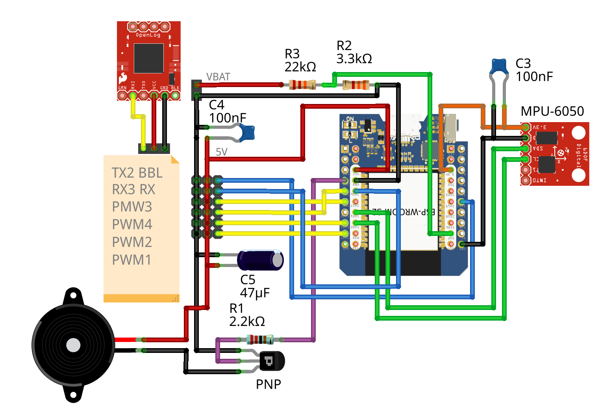
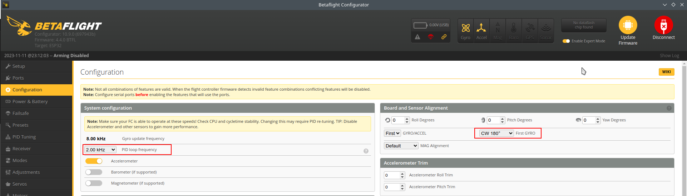
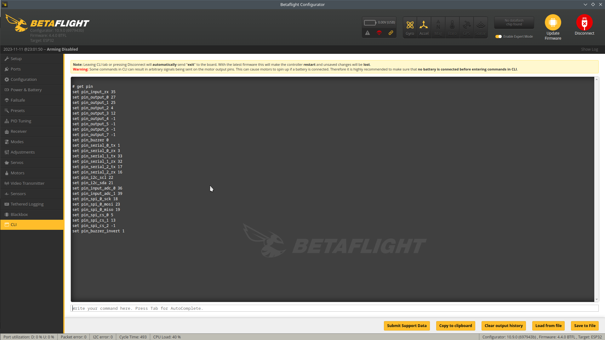
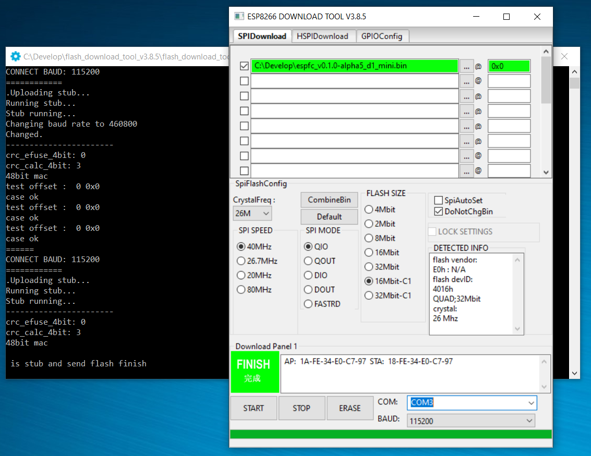
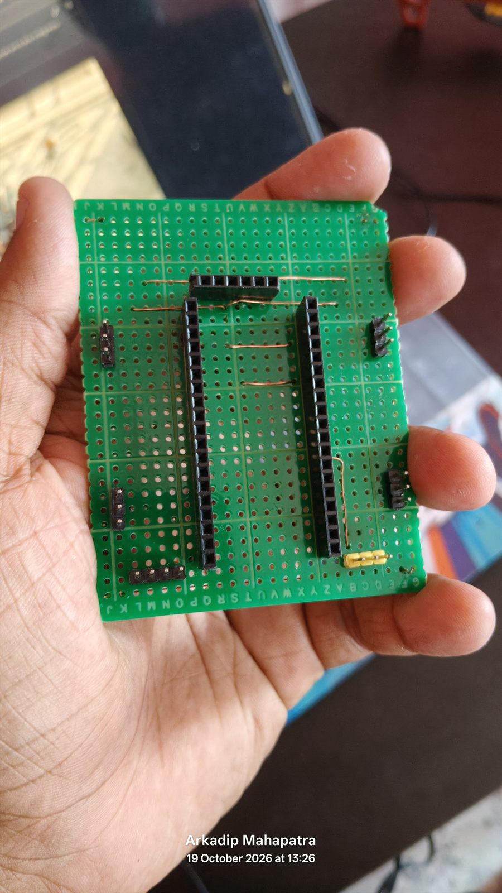
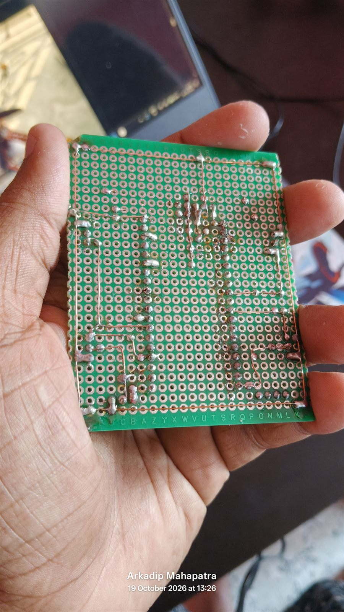
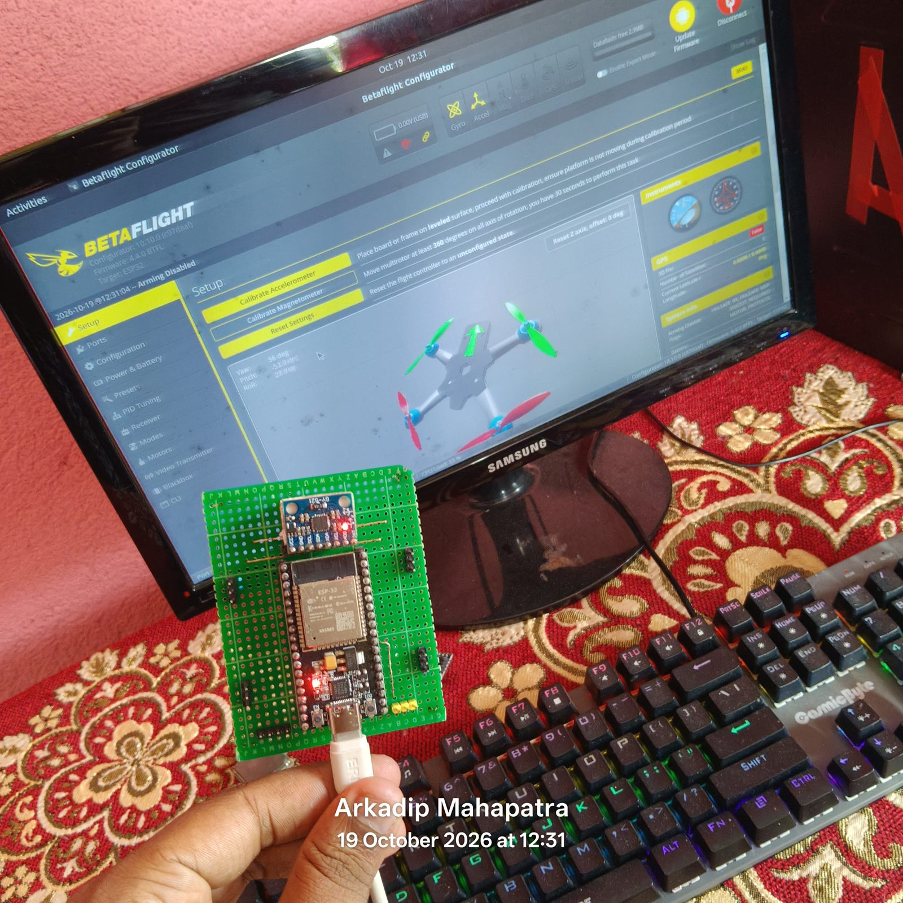
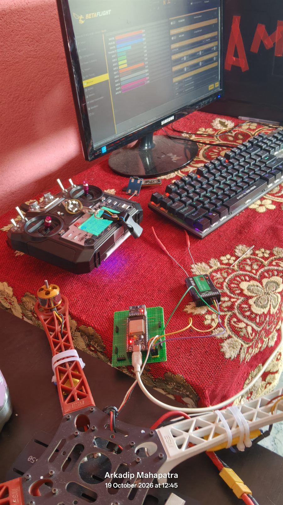

# 🚁 F450 Drone — ESP32 Flight Controller (ESP-FC)

<div align="center">


**A high-performance, open-source DIY flight controller for F450 quadcopters built from scratch on the ESP32 microcontroller running patched [ESP-FC](https://github.com/rtlopez/esp-fc) firmware with full Multi-Sensor diagnostic suites and Betaflight Configurator compatibility.**

</div>

---

## 🔗 Related Repositories (The F450 DIY Drone Series)

> This repository is **Part 1 of 3** in a modular, open-source F450 drone project ecosystem created by [@Arkadip2007](https://github.com/Arkadip2007). All three projects share identical airframes, ESCs, motors, and sensory payloads, but offer different microcontroller targets and flight firmware architectures:

| # | Repository | Target MCU | Firmware Stack | Ideal Use Case |
| :--- | :--- | :--- | :--- | :--- |
| 1 | **[F450-Drone-ESP32-FlightController](https://github.com/Arkadip2007/F450-Drone-ESP32-FlightController)** *(This Repo)* | ESP32-WROOM-32 (240MHz) | ESP-FC (v0.2.1 Patched) | Learning FC internals, Wi-Fi telemetry, dual-core DIY architecture |
| 2 | **[F450-Drone-STM32F411-Betaflight](https://github.com/Arkadip2007/F450-Drone-STM32F411-Betaflight)** | STM32F411CEU6 Black Pill | Betaflight 4.3.2 / 4.5.1 | Acrobatic freestyle tuning, ultra-fast PID loop, racing dynamics |
| 3 | **[F450-Drone-STM32F411-INAV](https://github.com/Arkadip2007/F450-Drone-STM32F411-INAV)** | STM32F411CEU6 Black Pill | INAV 5.1.0 / 6.0 Patched | Autonomous GPS navigation, Return-to-Home (RTH), Altitude/Position hold |

> **Common Shared Hardware:** F450 quadcopter frame, A2212 1000KV brushless motors, 30A SimonK analog PWM ESCs, 1045 propellers, 3S LiPo battery, MPU-6050 (GY-521), BMP280 (HW-611), HMC5883L (GY-271), NEO-6M GPS, and FlySky FS-i6 / FS-iA6B i-BUS radio system.

---

## 📋 Table of Contents

- [1. Executive Summary](#1-executive-summary)
- [2. Hardware Architecture & BOM](#2-hardware-architecture--bom)
- [3. System Architecture & High-Level Design](#3-system-architecture--high-level-design)
- [4. Low-Level Pin Mapping & Wiring](#4-low-level-pin-mapping--wiring)
- [5. 📸 Visual Schematics & Configurator Tour (Screenshots)](#5--visual-schematics--configurator-tour-screenshots)
- [6. The Fake/Clone MPU-6050 Challenge & Fix](#6-the-fakeclone-mpu-6050-challenge--fix)
- [7. Multi-Sensor Diagnostic Suite](#7-multi-sensor-diagnostic-suite)
- [8. Flashing & PlatformIO Build Guide](#8-flashing--platformio-build-guide)
- [9. 📘 Complete Engineering Q&A Journey](docs/engineering-qa-troubleshooting.md)
- [10. Repository Directory Structure](#10-repository-directory-structure)
- [11. License & Credits](#11-license--credits)

---

## 1. Executive Summary

> [!TIP]
> **🚀 Phase 1 Milestone Achieved: Full 4-Motor Physical Control Unlocked!**
> Bench-testing on the custom handmade green perfboard has achieved 100% success:
> - **100% Software Motor Control:** All 4 physical motors spin and respond dynamically via Betaflight Configurator and the RC transmitter, resolving the timer conflict encountered on the STM32 build.
> - **Smart Perimeter Ground Rail:** Continuous double-layer soldered copper ground bus enables modular zero-cost addition of future sensors without messy crossing wires.
> - **Cleared for Maiden Flight:** Tested with a minimal, rock-solid sensor setup (Gyro + Accel on MPU-6050) and ready for real-world test flight!

This repository provides everything needed to build, flash, verify, and fly an F450 quadcopter using an **ESP32-WROOM-32 (38-pin DevKit)**. 

### Key Highlights:
- **Zero-Dependency Diagnostics:** 4 standalone Arduino test sketches to verify sensors independently before touching flight firmware.
- **Custom Whitelisted Binary:** Precompiled ready-to-flash binary (`espfc_v0.2.1_esp32_custom_0x00.bin`) resolving the notorious Chinese clone MPU-6050 (`WHO_AM_I = 0x98`) detection lockup.
- **Betaflight Configurator Support:** Communicates over serial USB or Wi-Fi using MSP (MultiWii Serial Protocol), allowing full graphical PID tuning, receiver channel mapping, and motor testing.
- **Benchmark Performance:** Realized **691 Hz sensor loop rate** and over **323 KB free heap memory** with zero I2C bus collision on a shared 400kHz bus.

---

## 2. Hardware Architecture & BOM

| Component | Model / Variant | Protocol / Interface | Operating Voltage | Role / Function |
| :--- | :--- | :--- | :--- | :--- |
| **Microcontroller** | ESP32-WROOM-32 (38-Pin DevKit) | Dual-Core Xtensa @ 240MHz | 5V USB / 3.3V Logic | Flight controller core execution & Wi-Fi MSP |
| **Airframe** | F450 (450mm wheelbase) | Fiberglass & polyamide | N/A | High-stability quadcopter platform |
| **Propulsion Motors** | 4x A2212 1000KV | 3-Phase Brushless AC | 11.1V – 12.6V (3S) | Generates ~2800g total maximum thrust |
| **ESCs** | 4x 30A Yellow SimonK | Standard Analog PWM (50–400Hz) | 3S LiPo | Drives motors via hardware PWM signals |
| **Propellers** | 4x 1045 Slow-Fly (10×4.5") | 2x CW + 2x CCW | N/A | High-efficiency 10-inch lift generation |
| **Battery** | 3S LiPo (2200–3300 mAh) | XT60 / Deans | 11.1V (Nominal) | Main system power source |
| **Primary IMU** | MPU-6050 (GY-521 Module) | I2C (Address `0x68`) | 3.3V | 3-axis gyro + 3-axis accelerometer |
| **Barometer** | BMP280 (HW-611 Module) | I2C (Address `0x76`) | 3.3V | Atmospheric pressure & altitude sensing |
| **Compass / Mag** | GY-271 (Honeywell HMC5883L) | I2C (Address `0x1E`) | 3.3V | True compass heading & yaw correction |
| **GPS Telemetry** | u-blox NEO-6M / GPS-6M | UART Serial (9600 Baud) | 5V (from BEC) | Satellite positioning & coordinates |
| **RC Receiver** | FlySky FS-iA6B / FS-A8S | Serial i-BUS | 5V (from BEC) | 14-channel low-latency serial control |
| **RC Transmitter** | FlySky FS-i6 / FS-i6X | AFHDS 2A 2.4GHz | 4x AA Batteries | Ground radio transmitter (Mode 2) |

---

## 3. System Architecture & High-Level Design

### High-Level System Architecture



### Low-Level Firmware Pipeline (ESP-FC Architecture)



---

## 4. Low-Level Pin Mapping & Wiring

### Master Pinout Table

| ESP32 Pin | Connected Peripheral | Peripheral Pin | Protocol / Signal Type | Description & Notes |
| :--- | :--- | :--- | :--- | :--- |
| **GPIO 22** | MPU-6050, BMP280, HMC5883L | **SCL** | I2C Clock (400kHz) | Shared bus clock line |
| **GPIO 21** | MPU-6050, BMP280, HMC5883L | **SDA** | I2C Data (400kHz) | Shared bus bidirectional data line |
| **GPIO 16** | FlySky Receiver (FS-iA6B) | **i-BUS Signal** | UART2 RX (Serial) | FlySky serial protocol input |
| **GPIO 17** | NEO-6M GPS (Optional) | **TX Pin** | UART2 TX (Serial) | Transmit commands to GPS |
| **GPIO 27** | ESC 1 (Rear-Right) | PWM Signal | Hardware PWM (50-400Hz) | Motor 1 (Quad-X CCW) |
| **GPIO 25** | ESC 2 (Front-Right) | PWM Signal | Hardware PWM (50-400Hz) | Motor 2 (Quad-X CW) |
| **GPIO 4** | ESC 3 (Rear-Left) | PWM Signal | Hardware PWM (50-400Hz) | Motor 3 (Quad-X CW) |
| **GPIO 12** | ESC 4 (Front-Left) | PWM Signal | Hardware PWM (50-400Hz) | Motor 4 (Quad-X CCW) |
| **3.3V** | All I2C Sensors | VCC / 3.3V | Power Supply | Sensor power (from onboard LDO) |
| **GND** | All Components | GND | Common Ground | **Mandatory:** common ground across all modules |

---

## 5. 📸 Visual Schematics, Bench Hardware & Telemetry Tour

### Part A: Wiring Schematics & Wi-Fi Configurator (Screenshots)

#### 1. Complete ESP32 I2C Sensor Bus Wiring Schematic


> **Key Observations in this Schematic:**
> - **Shared I2C Bus:** SCL on **GPIO 22** and SDA on **GPIO 21** with parallel taps for MPU-6050 (`0x68`), BMP280 (`0x76`), and HMC5883L (`0x1E`).
> - **Clean Power Separation:** Sensors run on regulated 3.3V power from the ESP32 LDO; the FlySky receiver and GPS module run on 5V from the ESC BEC.

---

#### 2. Wireless Betaflight Configurator (Over ESP32 Wi-Fi MSP)
| Wireless Configurator GUI | CLI Hardware Pin Verification |
| :---: | :---: |
|  |  |
| Connects to Betaflight Configurator wirelessly via TCP/IP using MultiWii Serial Protocol (MSP). | Hardware resource allocation and timer mapping verification via the esp-fc CLI terminal. |

---

#### 3. Wi-Fi SoftAP Pairing & Browser Flasher
| ESP32 SoftAP Hotspot Discovery | WebSerial One-Click Browser Flasher |
| :---: | :---: |
|  |  |
| Onboard SoftAP mode (`esp-fc-xxxx`) allows instant connection from any computer without an external router. | Browser-based one-click flashing workflow using the Web Serial API and esptool.js. |

---

### Part B: Physical Flight Controller Hardware & Active Bench Motor Testing

#### 4. Handmade Green Perfboard PCB (Top Headers & Perimeter Ground Rail)
| Top View: Component Sockets & ESP32 Pin Headers | Bottom View: Continuous Perimeter Copper Ground Bus |
| :---: | :---: |
|  |  |
| Double-sided green plated perfboard with dual female header sockets for 30-pin ESP32 DevKit, sensor expansion headers, and power rails. | **Smart Perimeter Ground Architecture:** Continuous soldered double-layer copper ground rail encircling the entire board edge, eliminating tangled insulated jumper wires for ground returns. |

> **💡 Smart Prototyping Innovation (Double-Layer Perimeter Ground Rail):**
> Unlike traditional single-layer perfboard builds that require messy, crossing insulated wires for every ground connection, this board features a **continuous soldered copper bus surrounding the entire perimeter**. 
> - **Zero-Cost Modular Expansion:** Any future sensor (barometer, compass, GPS, or telemetry module) can instantly tap into ground from any edge of the board with a short jumper bridge.
> - **Clean Signal Integrity:** The outer ground loop helps shield sensitive I2C analog traces from high-frequency motor switching noise.

---

#### 5. Phase 1 Minimal Sensor Testing & Full 4-Motor Physical Control
| Minimal Reliable Sensor Verification (Betaflight) | Complete F450 Bench Setup with Active Motor Control |
| :---: | :---: |
|  |  |
| Handheld verification in Betaflight Configurator: 3D attitude tracking active with exactly 2 core sensors enabled (Gyro + Accelerometer). | Complete F450 quadcopter assembled with ESP32 flight controller wired to all 4 SimonK ESCs, validating full software motor spin and direction control. |

> **🎉 Major Milestone — 100% Software Motor Control Achieved:**
> In our STM32F411 build, timer mapping conflicts prevented the physical motors from spinning via software. **On this ESP32 flight controller, every single motor is fully and independently controllable via Betaflight Configurator and the RC transmitter!**
> 
> **Phase 1 Status:** 
> - **Sensor Configuration:** Kept intentionally minimal (Gyro + Accel on MPU-6050) to minimize I2C bus overhead and guarantee maximum loop frequency and flight stability.
> - **Ready for Maiden Flight:** The drone has passed all bench tests (ESC calibration, motor spin direction, stick response) and is cleared for its **real-world maiden flight test**!
> - **Phase 2 Roadmap:** Following a successful flight test, the remaining sensors (BMP280 barometer, QMC5883L compass, NEO-6M GPS) will be populated using the perimeter ground rails.

---

## 6. The Fake/Clone MPU-6050 Challenge & Fix

### The Root Problem
When purchasing GY-521 breakout boards, many vendors supply remarked clone chips (counterfeit silicon dies or re-marked MPU-6500s).
- **I2C Bus Address:** Both authentic and clone modules respond at I2C address `0x68`.
- **Silicon Chip ID (`WHO_AM_I` Register `0x75`):**
  - Authentic InvenSense MPU-6050 returns: `0x68` (Decimal 104)
  - Clone MPU-6050 returns: **`0x98`** (Decimal 152)

Because official ESP-FC v0.2.1 firmware enforced a strict whitelist (`whoami == 0x68 || whoami == 0x72`), the flight controller refused to boot, reporting sensor failure.

### The Patch
In `firmware/esp-fc-source/esp-fc-0.2.1/lib/Espfc/src/Device/GyroMPU6050.h`:

```cpp
// Line 245 in GyroMPU6050.h
bool testConnection() override
{
  uint8_t whoami = 0;
  uint8_t len = _bus->readByte(_addr, MPU6050_RA_WHO_AM_I, &whoami);
  // Patched to include 0x98:
  return len == 1 && (whoami == 0x68 || whoami == 0x72 || whoami == 0x98);
}
```

This single modification unlocks 100% full hardware functionality while preserving all internal math, filters, and attitude fusion algorithms.

---

## 7. Multi-Sensor Diagnostic Suite

Located under `sensor-tests/`, these Arduino sketches require **no third-party libraries** and allow complete pre-flight validation:

| Test Sketch | Location | What it Tests |
| :--- | :--- | :--- |
| **`all_sensors_live.ino`** | `sensor-tests/all-sensors-live/` | Runs MPU-6050, BMP280, HMC5883L, and GPS simultaneously. Computes live pitch, roll, heading, altitude, and ESP32 loop speed. |
| **`mpu6050_scanner.ino`** | `sensor-tests/mpu6050-scanner/` | Scans I2C bus, reads register `0x75`, detects clone status (`0x98`), wakes chip, reads raw gyro/accel. |
| **`bmp280_scanner.ino`** | `sensor-tests/bmp280-scanner/` | Reads chip ID (`0x58`), verifies 24-byte factory calibration tables, reads real-time temperature and barometric pressure. |
| **`gy271_scanner.ino`** | `sensor-tests/gy271-scanner/` | Detects whether compass is authentic Honeywell HMC5883L (`0x1E`), QMC5883L (`0x0D`), or QMC5883P (`0x2C`). Computes magnetic heading. |

---

## 8. Flashing & PlatformIO Build Guide

### Option A: Flash Precompiled Custom Binary (Easiest)

Using `esptool.py` (via Python or PlatformIO):

```bash
esptool.py --chip esp32 --port COM_PORT --baud 921600 write_flash -z 0x0 firmware/espfc-v0.2.1-custom-bin/espfc_v0.2.1_esp32_custom_0x00.bin
```

*(Replace `COM_PORT` with your ESP32's COM port, e.g., `COM3` on Windows or `/dev/ttyUSB0` on Linux).*

### Option B: Build from Source Using PlatformIO

1. Open `firmware/esp-fc-source/esp-fc-0.2.1` in VS Code with the **PlatformIO** extension installed.
2. Build the project:
   ```bash
   pio run -e esp32
   ```
3. Flash to the board:
   ```bash
   pio run -e esp32 --target upload
   ```

---

## 9. 📘 Complete Engineering Q&A Journey

For a comprehensive chronological breakdown of every problem faced during the ESP32 flight controller development, root-cause analyses, and solutions applied, see the dedicated engineering log:
- **[Complete Engineering Q&A Troubleshooting Guide (ESP32)](docs/engineering-qa-troubleshooting.md)**

---

## 10. Repository Directory Structure

```text
F450-Drone-ESP32-FlightController/
├── README.md                                # Master project documentation & guide
├── LICENSE                                  # MIT Open Source License
├── .gitignore                               # PlatformIO and build gitignore rules
│
├── firmware/
│   ├── README.md                            # Firmware flashing & build guide
│   ├── espfc-v0.2.1-custom-bin/
│   │   ├── README.md                        # Binary offset & flashing notes
│   │   └── espfc_v0.2.1_esp32_custom_0x00.bin # Precompiled ready-to-flash image
│   └── esp-fc-source/
│       └── esp-fc-0.2.1/                    # Complete patched source code tree
│           ├── platformio.ini               # PlatformIO build configuration
│           └── lib/Espfc/src/Device/GyroMPU6050.h # Patched gyro driver (0x98 whitelist)
│
├── sensor-tests/
│   ├── README.md                            # Hardware test suite documentation
│   ├── all-sensors-live/
│   │   ├── README.md
│   │   └── all_sensors_live.ino             # Comprehensive all-in-one telemetry sketch
│   ├── mpu6050-scanner/
│   │   ├── README.md
│   │   └── mpu6050_scanner.ino              # WHO_AM_I register & IMU test
│   ├── bmp280-scanner/
│   │   ├── README.md
│   │   └── bmp280_scanner.ino               # Barometer calibration & altitude test
│   └── gy271-scanner/
│       ├── README.md
│       └── gy271_scanner.ino                # Compass identification & heading test
│
└── docs/
    ├── README.md                            # Technical documentation directory
    ├── engineering-qa-troubleshooting.md    # Complete Q&A engineering journey & fixes
    ├── master-project-documentation.md      # Full engineering log & diagnostics
    ├── wiring-guide.md                      # Detailed step-by-step physical connections
    ├── flashing-guide.md                    # Detailed esptool and PlatformIO flashing instructions
    └── images/                              # Visual documentation & schematics
        ├── README.md                        # Image directory catalog & annotations
        ├── esp32-i2c-wiring-schematic.png   # Full breadboard & sensor wiring schematic
        ├── esp32-betaflight-configurator.png# Betaflight Configurator connected over Wi-Fi
        ├── esp32-cli-pin-assignment.png     # CLI hardware pin verification
        ├── esp32-wifi-ap-connection.png     # SoftAP Wi-Fi network pairing
        └── esp32-firmware-flasher.png       # Browser-based firmware flashing
```

---

## 11. License & Credits

- **Project Author:** [Arkadip Mahapatra](https://github.com/Arkadip2007)
- **Base Flight Firmware:** [ESP-FC by rtlopez](https://github.com/rtlopez/esp-fc)
- **License:** Licensed under the [MIT License](LICENSE).
